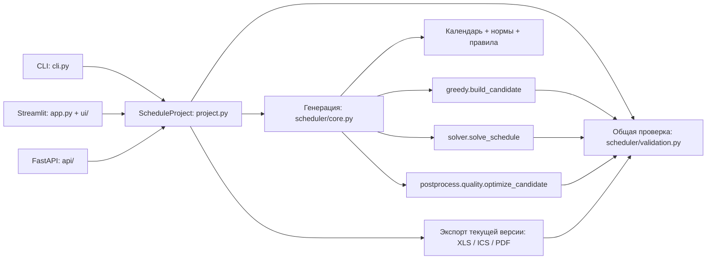

# Архитектура duty-schedule-gen v5

Актуальная карта реализации после аудита012 от2026-10-11. Контракты поведения
находятся в `specs/003–011`; правила разработки — в конституции и AGENTS.
[Полный индекс](docs/project-index.md) перечисляет каждый файл; JSON содержит
Python symbols/imports, requirement/test mappings и OpenAPI операции.
[Холодный старт](docs/cold-start.md) восстанавливает контекст из репозитория.

## Границы системы

Python3.12+, uv; Pydantic2 задаёт модели, FastAPI — HTTP, Typer — CLI, Streamlit —
UI. OR-Tools устанавливается extra `solver`; calendar использует HTTPX и полный
производственный календарь. Приложение stateless, постоянной БД и фоновых workers нет.
Рабочий проект — переносимый JSON, а локальные UI настройки — session_state.

## Модели и первичный источник состояния

`models.py`: Config/Employee/ProductionCalendar/CarryOver/PinnedAssignment,
DaySchedule/Schedule/ScheduleDiagnostic и подтверждения конкретного исключения.
`workload.py` определяет календарную, скорректированную и выбранную нормы,
а также фактические часы. SICK_LEAVE и VACATION не подменяют DAY_OFF.

`project.py`: ScheduleProject хранит версии по периодам. Правка создаёт новую
версию, инвалидирует проверку, сохраняет pins; повторное открытие проверяет
структуру и зависимости месяцев. Текущая версия едина для всех представлений,
статистики, экспорта и carry-over. `ensure_exportable` повторно проверяет график,
поэтому forged `status=ready` не разрешает экспорт.
Живой контракт: [REV](specs/009-schedule-revisions/spec.md).

## Генерация, ограничения и качество

`core.generate_schedule` выбирает greedy/CP-SAT, ведёт operation context и
возвращает проверенный результат. Greedy использует `build_candidate` и точный
`repair_employee_hours`, ограниченное число попыток и при наличии solver bounded
repair. Исчерпание эвристики, infeasible solver и timeout различаются; отсутствие
solver даёт задокументированный fallback. Старый `_build_day` удалён: он больше
не составлял график в продукте, а тесты теперь проверяют действующий алгоритм.

`scheduler/rules.py` задаёт доступность, допустимые назначения и правила серий;
`scheduler/validation.py` независимо проверяет полный месяц, покрытие, отсутствия,
роль/город, отдых, history, pins, нормы и approvals. Только валидный результат
получает ready; диагностический сохраняется и доступен для исправления.
[VALID](specs/004-scheduling-validity/spec.md), [HOURS](specs/008-workload-quality/spec.md).

`postprocess/quality.py` — действующая bounded лексикографическая оптимизация.
Порядок: парные выходные, короткие серии, баланс вечеров/ночей, нерабочих дежурств.
`pipeline.py` и его stages сохраняются как отдельно проверяемый интерфейс
постобработки: атомарность, сохранение пинов/часов и rollback имеют живой контракт
[POST](specs/005-postprocess-integrity/spec.md). Это не второй генератор ready.
`helpers.py`, `metrics.py` и `carry_over_calc.py` также используются потребителями.

## Календарь и история

`calendar.fetch_production_calendar`: полный период с working/off/short,
`pre=1`, источник, время получения и verified сохранённый fallback того же месяца.
`calendar_for_config` без полного календаря создаёт явно непроверенную модель
для диагностики; она не разрешает ready. Маркер legacy у history обозначает
недатированный старый вход, а не скрытый рабочий алгоритм. Его удаление уничтожило
бы диагностику неполной истории. [TIME](specs/007-calendar-shift-model/spec.md).

`multimonth.py` останавливается на первом diagnostic и сохраняет предыдущие ready.
Следующий месяц использует вычисленную историю текущей проверенной версии;
`xls_import.py` различает достоверную дату/счётчики и неполный старый файл.
[HIST](specs/006-month-continuity/spec.md).

## Адаптеры продукта

| Граница | Реализация | Проверяемое поведение |
|---|---|---|
| CLI | `cli.py`, `api_main.py` для API entrypoint | validate/generate/range/project export; явные ошибки и диагностика |
| API | `api/__init__.py`, routes, schemas, errors, planning | типизированный вход, plan/revision, JSON errors, thread-offloaded generation/export |
| Auth | `api/auth.py`, settings, ratelimit | auth включён по умолчанию; X-API-Key/Bearer; process-local sliding window |
| UI | `app.py` → `ui/components.py`; builders/config_io/state/views | atomic typed imports, календарь/history/norm/approvals, текущая версия, pins, save/open |
| XLS | `export/xls.py` | назначения, выбранные/фактические часы, метаданные истории, формулы |
| ICS | `export/ics.py`, filenames | персональные календари, временная модель, безопасные имена/ZIP |
| PDF | `export/pdf.py` | экранированные имена, запрет загрузки ресурсов, native PDF runtime |
| Метрики | stats/costs, api/whatif_service | единые часы/пулы и типизированные сценарии |

HTTP contract: [OpenAPI snapshot](specs/000-baseline/contracts/openapi.json),
[SEC](specs/003-secure-api-exports/spec.md). Snapshot обнаруживает schema drift;
runtime auth/error/rate-limit/generation проверяются отдельными contract tests.
UI контракт: [UIC](specs/010-ui-configuration/spec.md). Auth/rate-limit не создают
единую квоту между процессами; container/local network настройки не являются
cloud deployment. Production требует настройки ключей и инфраструктуры владельцем.

## SDD, проверки и поставка

Все изменения следуют spec→plan→tasks→analysis→implementation→tests/review→evidence.
`check_sdd.py` проверяет структуру, exact scope, test nodes, bidirectional IDs и
staged snapshot. `project_context.py` строит/проверяет полный индекс без исполнения
исходников; git state вычисляется live. Поддерживается Spec Kit1.1.3; runtime
продукта от него не зависит. Baseline хранит историю, feature contracts — текущие
требования. Архив старых комментариев NOTES удалён; решения сохраняются в specs.

CI Dev: lint/unit/integration/coverage/dependency audit/smoke. CI Test: platform
matrix+contract+mypy/security/solver/performance. CI Main: ещё macOS/UI/system,
installed wheel и packaged API/UI. SDD workflow независим и обязателен при
продвижении. [DEL](specs/011-delivery-assurance/spec.md).

Только прямые коммиты dev, push после коммита, затем GitHub PR dev→test→main.
Релиз при изменении версии проверяет конкретные SHA/version/bytes; reusable tag и
release jobs зависят от всех gates, а не от предположения о запуске tag-trigger.
Ограничения и реальные результаты аудита: [evidence012](specs/012-project-audit/evidence.md).
